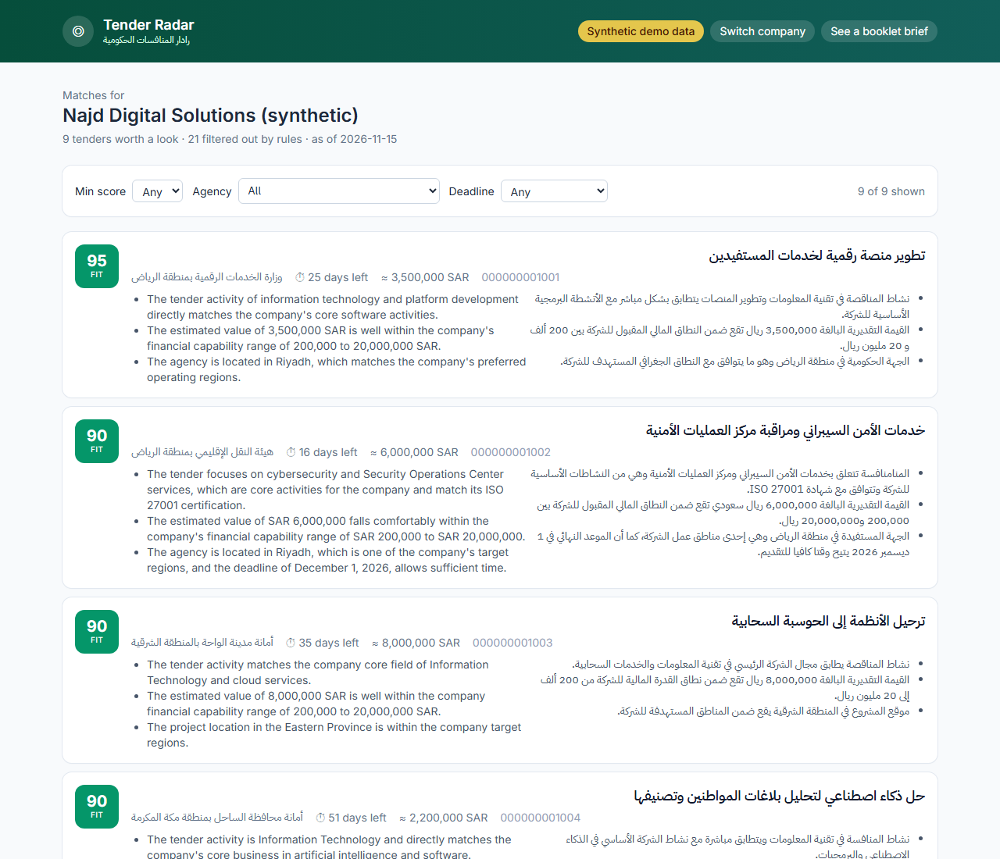
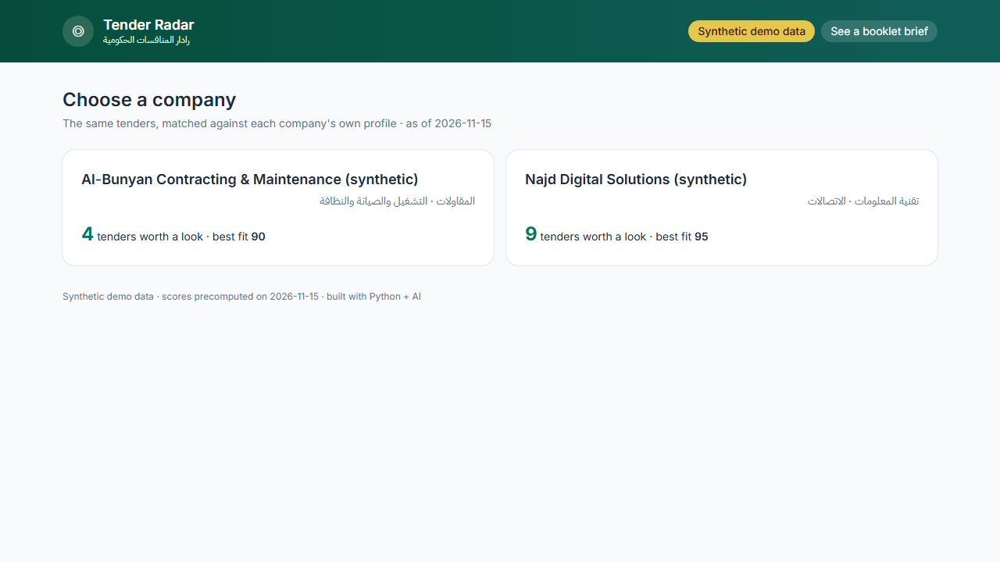
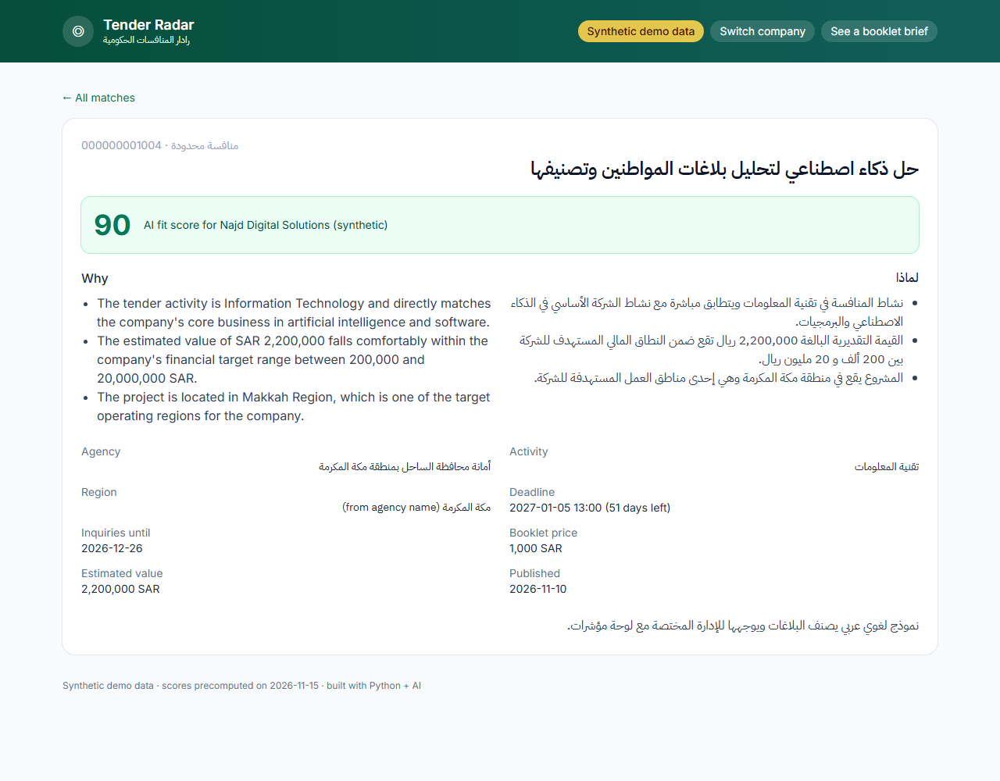
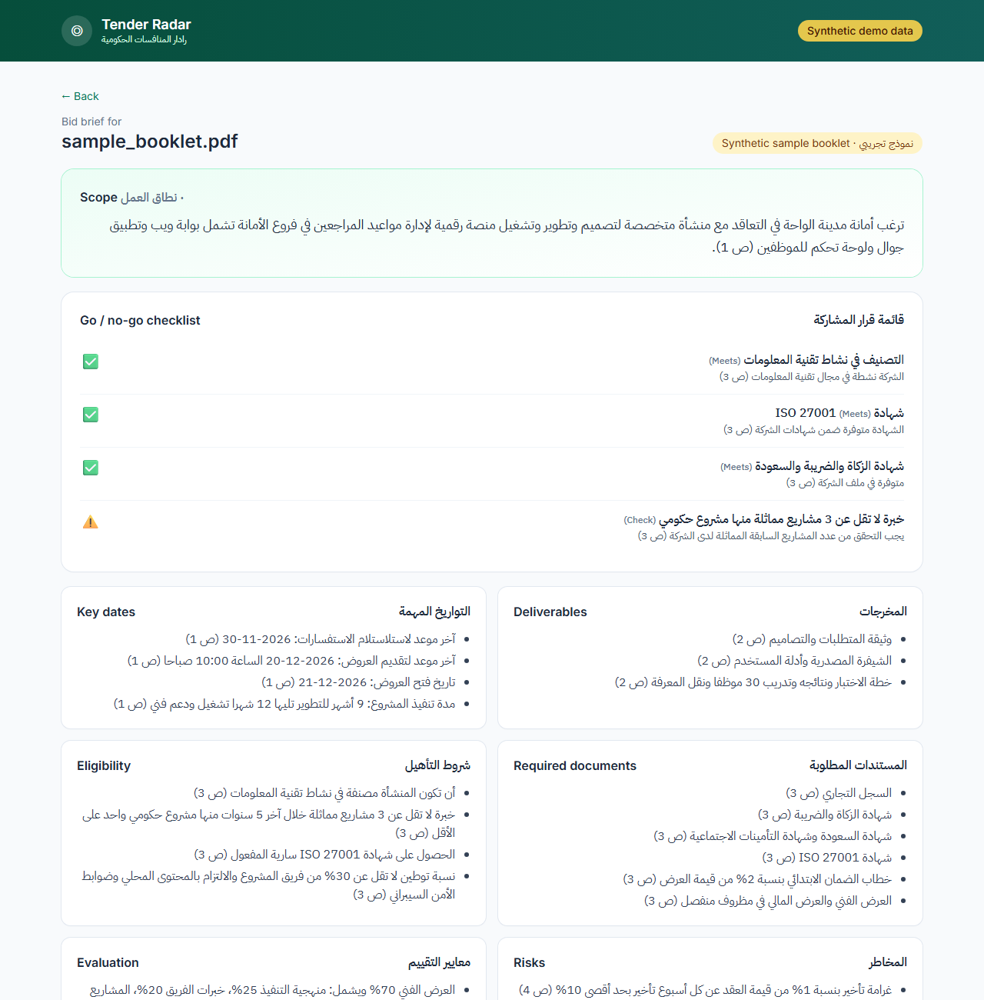
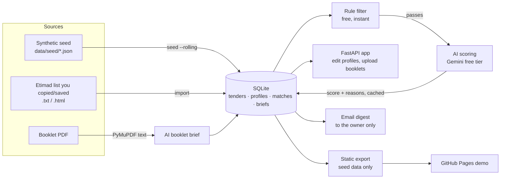

# Tender Radar · رادار المنافسات

**Finds Saudi government tenders that fit a company, explains the fit with AI (Arabic + English), and turns a tender booklet PDF into a one-page bid brief with a go/no-go checklist.**

Built for Saudi B2B companies: thousands of tenders appear on [Etimad](https://tenders.etimad.sa/Tender/AllTendersForVisitor), and a small bid team can't read them all. Tender Radar reads the list, drops what clearly doesn't fit, asks an AI to score what's left, and emails the best matches every morning.



> All data in the public demo is **synthetic**: fictional companies and agencies shaped like real Etimad listings. See [Data source and legal](#data-source-and-legal).

## What it does

| | |
|---|---|
| **Match** | A free rule filter (keywords, deadline, contract value, region, excluded agencies) runs first. An AI model then scores each remaining tender 0–100, with reasons in English and Arabic. |
| **Several companies** | The same tenders are matched against each company's profile. The demo has an IT services firm and a contracting & maintenance firm. |
| **Read a booklet** | Upload a tender booklet PDF (كراسة الشروط) and get the scope, deliverables, key dates, eligibility, required documents, evaluation criteria and risks. You also get a go/no-go checklist against the company's certifications. |
| **Daily, hands-free** | A GitHub Actions job runs every morning: fresh demo dates → matching → booklet brief → static demo → email digest. |
| **Import real tenders (private)** | Copy or save the public Etimad list in your browser; `import` turns it into tenders. Imported tenders are never published: they stay in your local database, go to your AI provider only for scoring, and reach only your own inbox. |

| Company chooser | Tender detail | Booklet brief |
|---|---|---|
|  |  |  |

## Architecture



- **Cheap before smart.** The rules reject roughly 70% of tenders for free. The AI only sees the plausible ones.
- **Never pay twice.** Each AI verdict is cached per (tender content, profile version). A tender is re-scored only if it or the profile changes.
- **Fails soft.** If the AI is down (503) or rate-limited (429), the tender is stored as *not scored* and retried on the next run. After repeated rate limits the run stops calling the AI. The demo is always rebuilt.
- **One page function, two outputs.** The live app and the static demo render through the same functions. The export only switches links to relative `.html` files and removes forms.
- **Swappable AI.** One `LLMProvider` interface. `FakeProvider` is used by tests (no network, no keys); `GeminiProvider` returns schema-validated JSON with a 60-second timeout.

Code map: `src/tender_radar/`
- `models.py`: data shapes (Pydantic)
- `arabic.py`: Arabic spelling normalisation
- `regions.py`: region from an agency name
- `matching/`: rules and AI scoring
- `ai/`: providers
- `reader/`: PDF → brief
- `importer/`: Etimad text/HTML
- `web/`: FastAPI app and templates
- `export/`: static site
- `digest.py`: email
- `__main__.py`: CLI

## Run it

Needs Python 3.12+.

```bash
python -m venv .venv
.venv/Scripts/pip install -e .[dev]        # Windows; on macOS/Linux use .venv/bin/pip
python -m tender_radar seed                 # synthetic tenders + two demo companies
python -m tender_radar match                # rules + AI (the "fake" AI unless you add a key)
python -m tender_radar brief data/seed/sample_booklet.pdf
uvicorn tender_radar.web.app:create_app --factory   # http://127.0.0.1:8000
```

| Command | What it does |
|---|---|
| `seed [--rolling]` | Load demo data. `--rolling` moves every date so the demo is always current. |
| `match [--profile ID]` | Score tenders for every company, or one. |
| `brief PDF [--profile ID]` | Summarise a booklet and check eligibility. |
| `import FILE...` | Import Etimad list text (`.txt`, copied with Ctrl+A, Ctrl+C) or a saved page (`.html`). |
| `export --out site` | Write the read-only demo (seed tenders only). |
| `digest [--dry-run]` | Email today's best matches to yourself; without SMTP it saves an HTML preview. |
| `daily --out site` | Everything above, in order. This is what GitHub Actions runs. |

**Settings** (environment variables or a git-ignored `.env`, see `.env.example`):
- **AI:** `TR_AI_PROVIDER=gemini`, `GEMINI_API_KEY`, `TR_GEMINI_MODEL`. The free key is at [aistudio.google.com/apikey](https://aistudio.google.com/apikey).
- **Email:** `TR_SMTP_*` and `TR_DIGEST_TO`. For Gmail use an app password.
- **Database:** `TR_DATABASE_URL` (SQLite by default).

> Upgrading from an older checkout: delete old `*.db` files and any `site/` folder made by an earlier version, then run `seed` again. The export only clears folders it created itself.

**Tests:** `pytest -q` (127 tests; they use the fake AI and never touch the network or send email).

## Cost: zero

- **AI:** Gemini free tier. About 15 scoring calls plus 1 brief per day for the demo, well under the free quota.
- **Hosting:** GitHub Actions and GitHub Pages (free for public repos).
- **Static demo:** precomputed, so visitors never trigger an AI call and the page is never "asleep".

## How good is the matching? (honest numbers)

- **Test set:** 20 synthetic tenders, labelled by hand ("would this company bid?").
- **Result:** the pipeline agreed with the human decision on **19/20**.
- **Caveat:** that set mostly tests the rule filter. A constant fake AI also scores 19/20, because the rules do the heavy lifting.
- **Observed:** with `gemini-3.5-flash-lite` the AI puts almost every plausible IT tender at 85–90. Its reasons are sensible, but it separates *good* from *great* poorly.
- **Next step:** tricky test cases (hardware-only supply, missing certification, out-of-scope consulting) and prompt calibration.

So the defensible claim is *"the pipeline matched human bid decisions on 19/20 synthetic tenders"*, not *"the AI is 95% accurate"*. Run the evaluation yourself with `python scripts/eval_matching.py`.

## Data source and legal

- **Recon (2026-11-15):**
  - Etimad's public tender pages show a CAPTCHA to automated clients, and this project never tries to bypass it.
  - Etimad's usage policy (clauses 3 and 10) forbids copying or republishing its content without written permission.
  - The developer API offers no tender list.
- **What this project does instead:**
  - **The public demo is synthetic.** The export refuses to include anything but seed data, and tests enforce that.
  - **Real tenders come only from a person.** They copy or save the public list in a normal browser, then run `import`. They are never published: they stay in the local database, their title, agency and activity are sent to the AI provider for scoring, and they appear only in the owner's own email digest. Imported files live in the git-ignored `data/imports/`.
  - **A written permission request** to NCGR, the operator of Etimad, has been drafted ([docs/etimad-permission-request.md](docs/etimad-permission-request.md)). Automatic collection or public use of real data waits for that answer, or for an official open-data source.
- **Booklets:** the sample booklet is synthetic. Don't upload confidential company documents while using the free AI tier: Google may use free-tier inputs to improve its models.

## What I did / what AI did

**Me:**
- chose the problem and the users (Saudi B2B bid teams)
- set the constraints: Python, free-only, no scraping, real data kept private
- approved the design and each plan
- checked Etimad's terms myself
- labelled the evaluation set
- decided how to handle the data source

**AI coding agents (Claude Code):** wrote the code test-first from those written specs and plans, under my direction. The design, plans and decision logs are in `docs/superpowers/`. I'm working through every module so I can explain how and why it works.

## Roadmap

- [ ] "Ask the booklet": questions answered from the booklet, with page citations
- [ ] Calibrate scoring with harder evaluation cases
- [ ] Official data source once permission or open data is available
- [ ] Visual design refresh and a 2-minute demo video
